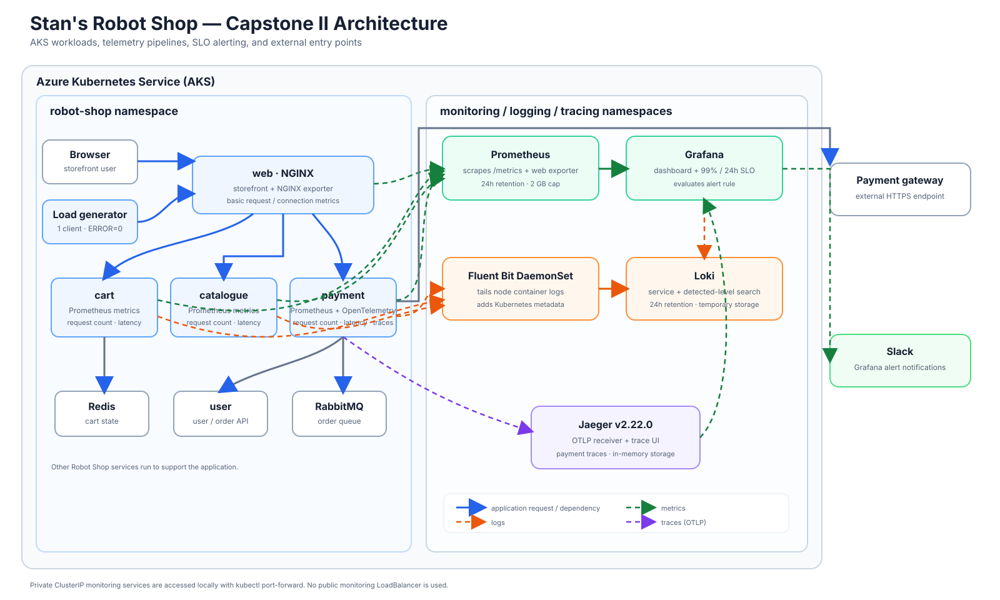

# Stan's Robot Shop — Capstone II Observability Project

This repository contains the capstone work to deploy Stan's Robot Shop to
Kubernetes and add metrics, dashboards, logs, traces, an availability SLO, a
Slack alert, and a controlled incident drill.

The application is deployed to an existing Azure Kubernetes Service (AKS)
cluster. The instructions below document the implementation and provide a
repeatable path through the main steps. Commands that change a live cluster
should be run only after confirming the active Kubernetes context and
understanding their effect.

## Project outcomes

- Deploy Robot Shop using its Helm chart in `K8s/helm`.
- Instrument the `cart`, `catalogue`, and `payment` APIs with Prometheus
  request-count and latency metrics.
- Collect basic NGINX exporter metrics for `web`.
- Install Prometheus and Grafana for metrics and dashboards.
- Collect Kubernetes container logs with Fluent Bit and store them in Loki.
- Add OpenTelemetry traces from the payment service to Jaeger.
- Define a 99% rolling 24-hour request-availability SLO and error budget.
- Route the Grafana SLO alert to Slack.
- Perform a reversible payment failure drill and document its results.

The capstone focuses on `web`, `catalogue`, `cart`, and `payment`. Other Robot
Shop services are deployed to support the application.

## Architecture



Prometheus, Loki, and Jaeger are installed as private, in-cluster services.
Their local interfaces are accessed with `kubectl port-forward`; no public
monitoring LoadBalancer is required.

## Getting the code

Fork the upstream project
[`instana/robot-shop`](https://github.com/instana/robot-shop) to your own
GitHub account, then clone your fork. For this implementation, the fork is
[`Godwin-Techie/robot-shop`](https://github.com/Godwin-Techie/robot-shop):

```bash
git clone https://github.com/Godwin-Techie/robot-shop.git
cd robot-shop
git remote add upstream https://github.com/instana/robot-shop.git
git remote -v
```

If `upstream` is already configured, inspect it with `git remote -v` rather
than adding it a second time. Keep project changes on your fork; do not push
credentials or generated secrets.

## Repository map

| Path | Purpose |
|---|---|
| `K8s/helm/` | Robot Shop Helm chart and project-specific image values |
| `K8s/load-deployment.yaml` | Low-volume in-cluster load generator |
| `cart/server.js` | Cart Prometheus request metrics |
| `catalogue/server.js` | Catalogue Prometheus request metrics |
| `payment/payment.py` | Payment Prometheus metrics and OpenTelemetry tracing |
| `web/` | Web container and NGINX status endpoint for the exporter |
| `K8s/monitoring/prometheus-values.yaml` | Prometheus/Grafana resource and retention settings |
| `K8s/monitoring/loki-values.yaml` | Single-replica, temporary-filesystem Loki settings |
| `K8s/monitoring/fluent-bit-values.yaml` | Kubernetes container log collection and Loki output |
| `K8s/monitoring/jaeger.yaml` | Jaeger v2.22.0 all-in-one deployment |
| `K8s/monitoring/architecture.svg` | Capstone application and observability architecture diagram |
| `K8s/monitoring/dashboards/robot-shop-overview.json` | Grafana dashboard exported as code |
| `K8s/monitoring/availability-slo.md` | Availability objective, SLI query, and error budget |
| `K8s/monitoring/incident-postmortem.md` | Blameless report from the payment failure drill |

## Requirements

- A Kubernetes cluster with a working `kubectl` context; this project used AKS.
- `kubectl`, Helm 3, Docker, and access to the cluster.
- A container registry accessible to the cluster. The image values in
  `K8s/helm/values.yaml` currently use the `device66` Docker Hub namespace.
- Grafana access and a Slack workspace if configuring Slack notifications.
- Enough cluster CPU and memory for the application and monitoring workloads.
  This cluster had two small AKS nodes and limited CPU request headroom; check
  scheduling capacity before installing additional workloads.

Do not put registry passwords, Slack webhooks, or other credentials in this
repository. Authenticate interactively with the relevant CLI and enter webhook
URLs directly into Grafana.

## 1. Check the Kubernetes context and capacity

Before applying anything, verify the cluster and nodes:

```bash
kubectl config current-context
kubectl get nodes -o wide
kubectl describe nodes
```

Check the allocated resource requests in the `Allocated resources` section of
`kubectl describe nodes`. Low observed CPU usage does not necessarily mean that
the scheduler can place another pod: scheduling uses resource requests.

## 2. Build and publish the customized application images

The focused application services use separate image tags. From the repository
root, authenticate to the registry using your local Docker login flow, then
build and push the image tags referenced in `K8s/helm/values.yaml`:

```bash
docker build -t device66/rs-cart:capstone2-v1 ./cart
docker build -t device66/rs-catalogue:capstone2-v1 ./catalogue
docker build -t device66/rs-payment:capstone2-v2 ./payment
docker build -t device66/rs-web:capstone2-v1 ./web

docker push device66/rs-cart:capstone2-v1
docker push device66/rs-catalogue:capstone2-v1
docker push device66/rs-payment:capstone2-v2
docker push device66/rs-web:capstone2-v1
```

The payment image includes the pinned OpenTelemetry Python dependencies in
`payment/requirements.txt`. The payment service instruments Flask requests and
outbound `requests` calls and exports OTLP/gRPC to
`jaeger-collector.tracing.svc.cluster.local:4317`.

If using a different registry, change the service image values in
`K8s/helm/values.yaml` and make sure the AKS nodes can pull the images.

## 3. Deploy Robot Shop and a modest load generator

Install or update the application using the repository chart:

```bash
helm upgrade --install robot-shop K8s/helm \
  --namespace robot-shop \
  --create-namespace \
  --values K8s/helm/values.yaml \
  --wait \
  --timeout 10m
```

Deploy the low-volume load generator:

```bash
kubectl apply -n robot-shop -f K8s/load-deployment.yaml
```

The manifest is deliberately configured with one client and `ERROR=0`.
Confirm the application pods are running before proceeding:

```bash
kubectl get pods -n robot-shop -o wide
kubectl get services -n robot-shop
```

To view the store locally, port-forward the web service:

```bash
kubectl port-forward -n robot-shop svc/web 8080:8080
```

Then open <http://localhost:8080>. Keep the port-forward terminal open while
using the site.

### Redis storage-class note

The Redis StatefulSet has a persistent volume claim template. Its storage class
is immutable after creation. The values in this project use
`redis.storageClassName: default` to match the existing AKS claim. For another
cluster, inspect available storage classes and select the intended one before
the first install. Do not change the storage class on an existing StatefulSet
as part of an unrelated Helm upgrade.

## 4. Install Prometheus and Grafana

Add the Prometheus Community chart repository and install the stack with the
project values:

```bash
helm repo add prometheus-community \
  https://prometheus-community.github.io/helm-charts
helm repo update

helm upgrade --install monitoring \
  prometheus-community/kube-prometheus-stack \
  --namespace monitoring \
  --create-namespace \
  --values K8s/monitoring/prometheus-values.yaml \
  --wait \
  --timeout 10m
```

The project configuration limits resource requests and configures Prometheus
for 24-hour retention with a 2 GB retention-size limit. The size cap may evict
samples before 24 hours if metrics volume grows; confirm data availability
before relying on a full rolling window.

Check the release and monitored targets:

```bash
helm list -n monitoring
kubectl get pods -n monitoring
kubectl get servicemonitor -A
```

Port-forward Grafana:

```bash
kubectl port-forward -n monitoring \
  svc/monitoring-grafana 3000:80
```

Open <http://localhost:3000>. Retrieve the generated Grafana admin password
from the cluster's Grafana secret locally if required; do not commit or share
it.

The Robot Shop chart includes ServiceMonitors for the cart, catalogue, payment,
and web exporter services. Verify the targets are `UP` in Grafana under
**Connections → Data sources → Prometheus → Build a dashboard** or in
**Status → Targets**, depending on the Grafana/Prometheus UI version.

## 5. Build and export the service dashboard

The dashboard is available in Grafana and its exported JSON is stored at
`K8s/monitoring/dashboards/robot-shop-overview.json`. It includes service
request rate, error, and latency views for cart, catalogue, and payment, plus
basic web request and active-connection panels.

The web exporter provides basic NGINX metrics only; it does not provide the
same HTTP status-code and latency SLI as the instrumented APIs. Avoid
describing those web panels as web availability or web error-rate measurements.

If changing the dashboard in Grafana:

1. Open **Dashboards → Robot Shop Service Overview**.
2. Make and save the changes.
3. Export/download the dashboard JSON.
4. Replace `K8s/monitoring/dashboards/robot-shop-overview.json` with the new
   export.
5. Check that the file is valid JSON before handing it in.

## 6. Install Loki and Fluent Bit for logs

Add the chart repositories:

```bash
helm repo add grafana-community \
  https://grafana-community.github.io/helm-charts
helm repo add fluent https://fluent.github.io/helm-charts
helm repo update
```

Install Loki with the project configuration:

```bash
helm upgrade --install loki grafana-community/loki \
  --namespace logging \
  --create-namespace \
  --values K8s/monitoring/loki-values.yaml \
  --wait \
  --timeout 10m
```

Install Fluent Bit:

```bash
helm upgrade --install fluent-bit fluent/fluent-bit \
  --namespace logging \
  --values K8s/monitoring/fluent-bit-values.yaml \
  --wait \
  --timeout 10m
```

The Fluent Bit DaemonSet tails container logs, adds Kubernetes metadata, and
sends them to the in-cluster Loki gateway. It labels streams with job,
namespace, service, and container. Check that Loki and one Fluent Bit pod per
node are Ready:

```bash
kubectl get pods -n logging -o wide
```

In Grafana, add a Loki data source with this in-cluster URL:

```text
http://loki-gateway.logging.svc.cluster.local
```

Save and test the data source. In **Explore**, select Loki and query by
service:

```logql
{namespace="robot-shop", service="payment"}
```

The `detected_level` value is parsed log metadata, not necessarily an indexed
stream label. To search payment errors, use a LogQL pipeline filter:

```logql
{namespace="robot-shop", service="payment"} | detected_level="error"
```

The filter was verified against the payment failure drill logs. Loki is
configured as a single replica with temporary filesystem storage and 24-hour
retention; log data can be lost on pod restart and is not intended as durable
production storage.

## 7. Deploy Jaeger and verify a payment trace

Deploy the Jaeger v2.22.0 all-in-one instance:

```bash
kubectl apply -f K8s/monitoring/jaeger.yaml
kubectl rollout status deployment/jaeger \
  --namespace tracing \
  --timeout=5m
```

Jaeger runs with in-memory storage and exposes only a ClusterIP service.
Port-forward its UI:

```bash
kubectl port-forward -n tracing \
  svc/jaeger-collector 16686:16686
```

Open <http://localhost:16686>. In Jaeger, choose service `payment`, leave the
operation unrestricted, select a suitable lookback (for example, 1 hour), and
search. The trace should include the incoming `POST /pay/<id>` span and
outbound HTTP spans.

In-memory traces disappear if the Jaeger pod restarts. The payment application
exports to Jaeger's OTLP/gRPC endpoint on port 4317.

## 8. Define and display the availability SLO

The SLO is documented in `K8s/monitoring/availability-slo.md`:

- **Target:** 99% availability over a rolling 24-hour window.
- **Scope:** combined cart, catalogue, and payment API requests.
- **Good response:** HTTP 100–499.
- **Bad response:** HTTP 500–599.
- **Excluded traffic:** `/health` and `/metrics`.
- **Budget:** 1% of eligible requests. At steady traffic this is equivalent
  to 14.4 minutes per day, but the actual SLO is request-based, not wall-clock
  downtime.

The request counter names differ: cart and payment use
`robotshop_http_requests_total`, while catalogue uses
`robotshop_http_requests`. The SLI query accounts for both:

```promql
100 *
(
  sum(increase(robotshop_http_requests_total{
    service=~"cart|payment",
    status_code=~"[1-4][0-9][0-9]"
  }[24h]))
  +
  sum(increase(robotshop_http_requests{
    service="catalogue",
    status_code=~"[1-4][0-9][0-9]"
  }[24h]))
)
/
(
  sum(increase(robotshop_http_requests_total{
    service=~"cart|payment"
  }[24h]))
  +
  sum(increase(robotshop_http_requests{
    service="catalogue"
  }[24h]))
)
```

This combined SLI is request-weighted, so a high-traffic service can mask
degradation in a lower-traffic service. Load-generator traffic is included.
The objective measures the instrumented API requests, not direct browser
availability.

In Grafana, add this query to the **Robot Shop Service Overview** dashboard as
a time-series panel, set the unit to **Percent (0–100)**, and add a threshold
at `99`. The exported dashboard JSON should be kept in
`K8s/monitoring/dashboards/`.

## 9. Create the Grafana alert and Slack contact point

Create a Grafana alert rule using the same PromQL query:

1. Name it **Combined API availability below 99%**.
2. Use a Prometheus **instant** query for the current rolling 24-hour value.
3. Set the condition to fire when the result is **below 99**.
4. Evaluate every 1 minute and use a 5-minute pending period.
5. Route notifications to the Slack contact point.

Create the Slack contact point in **Alerting → Contact points** using a Slack
Incoming Webhook. Keep the webhook URL private and enter it only in Grafana.
Test the contact point before associating it with the rule. The SLO rule is
currently configured to send to Slack.

An alert state of `Normal` means the measured SLI is at or above the threshold;
it does not prove that a complete 24-hour measurement window exists. An alert
may remain `Firing` after service recovery while drill failures remain inside
the rolling window.

## 10. Perform a controlled payment incident drill

The completed drill is documented in
`K8s/monitoring/incident-postmortem.md`. It temporarily directed payment to a
reserved `.invalid` hostname, verified a 500 response, sent a bounded batch of
synthetic requests, and restored the normal Helm configuration. Grafana fired
the SLO alert and delivered a Slack notification.

**Do not repeat the batch against a production system.** This drill deliberately
causes payment failures and should only be run in an isolated learning
environment with authorization. If repeating it in this capstone cluster:

1. Confirm the normal payment setting is `gateway: null` in
   `K8s/helm/values.yaml` and the payment service is healthy.
2. Temporarily set the Helm value with
   `--set-string payment.gateway=https://gateway.slo-drill.invalid`.
3. Wait for the payment rollout and send one test request first.
4. Only if the test behaves as expected, carry out the explicitly authorized,
   bounded drill.
5. Immediately restore the normal Helm release with the repository values and
   verify the payment pod is Ready.
6. Verify the SLI, Grafana rule, and Slack notification.

The payment gateway setting is optional. The Helm template renders it only
when provided; its indentation was corrected and both configured and
unconfigured renders were verified.

## Current status and limitations

- Payment tracing was verified in Jaeger.
- The SLO query returned 100% before the drill; the controlled drill brought
  the rolling SLI below its 99% target.
- After restoring the gateway, the payment pod was Ready, but the rolling SLO
  alert remained Firing while the drill failures were still in the window.
  It should resolve when the rolling result recovers above 99%; refresh the
  Grafana rule to verify.
- Loki service-and-level search was verified with the drill's payment errors.
- The dashboard export, SLO document, and incident postmortem are in the
  repository.
- Prometheus is configured for a 24-hour retention window, with a 2 GB size
  cap. The SLO must not be treated as a complete rolling 24-hour measurement
  until sufficient history is available and the size cap has not removed it.
- Loki uses temporary, non-persistent filesystem storage; Jaeger uses
  in-memory storage. Their data is suitable for this capstone exercise, not
  durable production retention.
- Web metrics are basic NGINX exporter metrics and do not provide the API
  request counter used in the availability SLO.
- The combined SLO is traffic-weighted and includes synthetic load. Per-service
  objectives and a no-traffic/synthetic health alert remain possible follow-up
  improvements.

## Useful verification commands

```bash
# Application
kubectl get pods -n robot-shop -o wide
kubectl get servicemonitor -n robot-shop

# Metrics/logging/tracing workloads
kubectl get pods -n monitoring
kubectl get pods -n logging
kubectl get pods -n tracing

# Current payment image and status
kubectl get deployment payment -n robot-shop -o wide

# Helm releases
helm list -A

# Validate the dashboard JSON
python3 -m json.tool K8s/monitoring/dashboards/robot-shop-overview.json \
  >/dev/null

# Check patch whitespace
git diff --check
```

For local UIs, keep each `kubectl port-forward` command running in its own
terminal. If a forward stops after a pod rollout or a cluster DNS/API timeout,
stop that old forward and start it again.
